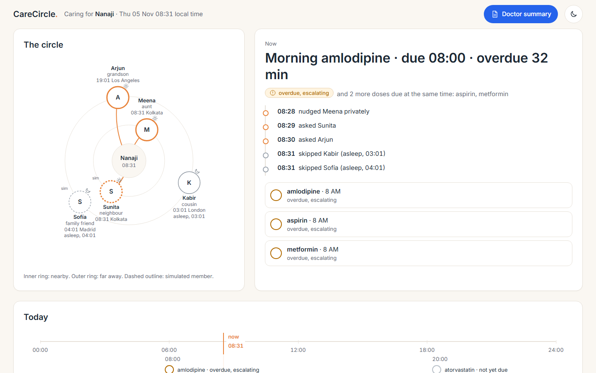
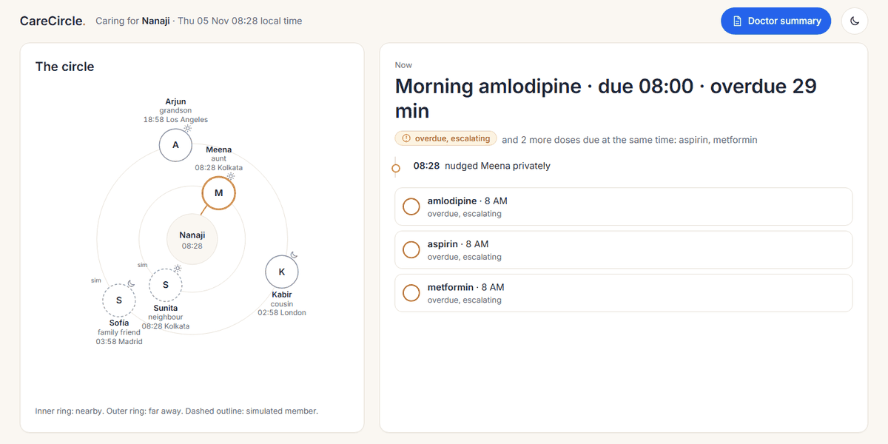
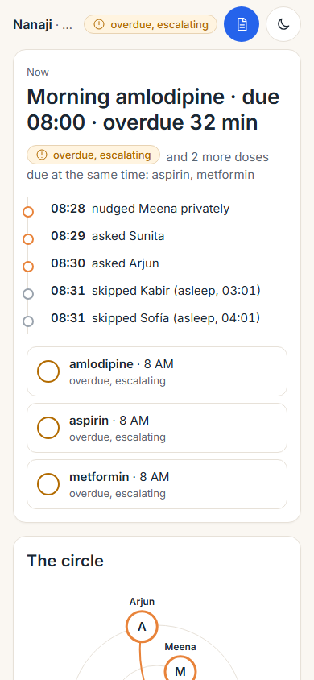
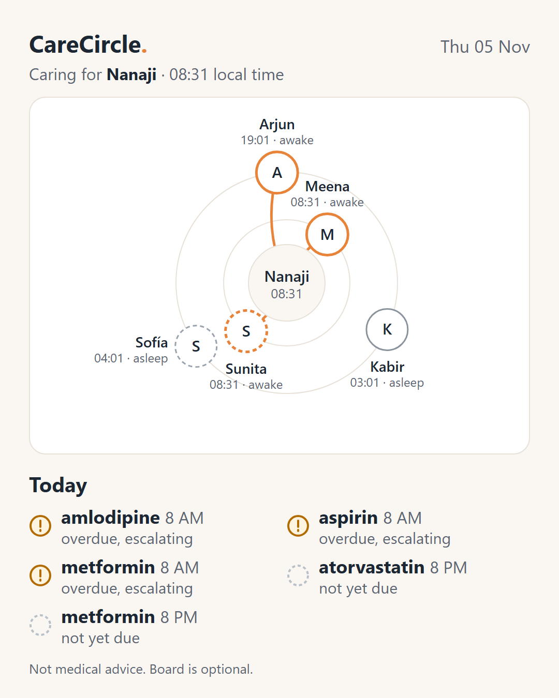
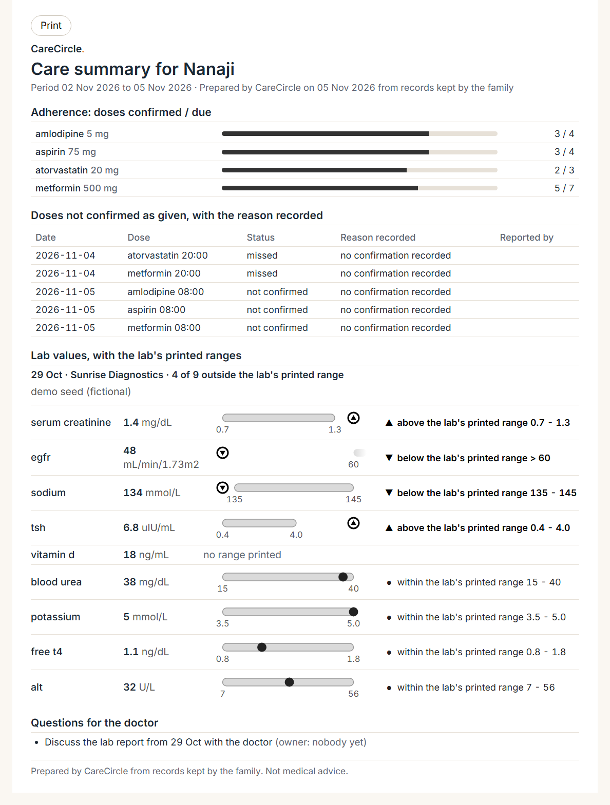

# CareCircle

**The family care coordinator that lives in WhatsApp, across every time zone your family lives in.**

When someone we love is ill, the people who care for them are scattered: a grandson in Los Angeles, a cousin in London, a friend in Madrid, an aunt at the bedside. CareCircle turns the chat they already use into one shared care record. Photograph the discharge sheet and confirm it with one "yes". From then on CareCircle knows whose turn it is, privately nudges the person on duty when a dose isn't confirmed, then asks whoever is awake next, in their own language. It reads voice notes and pill-organiser photos, compares lab values with the lab's own printed ranges, and keeps a one-page summary ready for the doctor.

**It coordinates. It never gives medical advice.**

**[Watch the 3-minute demo](https://youtu.be/4g2Ha4-6-xU)** · **[Try the interactive replay](https://aggarmoksh.github.io/carecircle/replay.html)** · [How it was tested](docs/EVALS.md) · [Architecture](docs/ARCHITECTURE.md)



*The board, mid-escalation. Kabir is asleep in London (03:01), so he isn't asked; the orange line runs to Arjun, awake in Los Angeles. Dashed members are simulated. Fictional demo data.*

Built on **Meta Muse Spark 1.3** and **Meta Muse Voice Transcribe**, running on real WhatsApp today.

---

## Why it matters

- **63 million Americans, roughly 1 in 4 adults, are family caregivers**, up 45% in a decade ([AARP and NAC, *Caregiving in the US 2025*](https://www.aarp.org/caregiving/basics/caregiving-in-us-survey-2025/)). Many of them live in a different city or country from the person they care for.
- **About half of people with long-term conditions don't take their medicines as prescribed** ([WHO, *Adherence to Long-Term Therapies*, 2003](https://iris.who.int/handle/10665/42682)), and poor adherence is linked to an estimated 33 to 69% of medication-related hospital admissions ([Osterberg and Blaschke, *NEJM*, 2005](https://www.nejm.org/doi/full/10.1056/NEJMra050100)).

The failure isn't knowledge; it's coordination. A parent comes home with a discharge sheet, and the people helping each hold a piece of the picture. When we described CareCircle to caregivers online:
- One said their family group chat "would blow up at 2am" and a sister in another city woke to dozens of messages with no context.
- Another keeps a 150-page shared document and copies messages into it by hand.
- A third told us doctors want paper, not apps.

CareCircle answers all three: a quiet, private nudge instead of a group blast, a care log that writes itself, and a one-page printable summary for the doctor.

## What it does

| | |
|---|---|
| **1. Reads the discharge sheet** | A member photographs it on WhatsApp. **Muse Spark** reads every medicine, dose, unit (exactly as printed) and time. Nothing goes live until a member replies YES (also "sí" or "हाँ"). Handwritten lines must be confirmed by a person, name by name. |
| **2. Logs doses the way families talk** | "Maine Nanaji ko subah ki metformin de di." **Muse Voice Transcribe** hears the voice note in Hindi, Punjabi, English or a mix; Spark matches it to the right dose on the live schedule. |
| **3. Chases the right person, privately** | A dose that isn't confirmed gets one private message to whoever is on duty, never a group blast. No answer: the next person who is awake is asked. Doses due together are one question, and "done" confirms them all. |
| **4. Checks the pill organiser** | One photo of the weekly organiser and Spark reads all 14 compartments, then compares them with what the family confirmed: "Wednesday PM is still full: that dose wasn't given." |
| **5. Keeps labs and the doctor in the loop** | Lab reports are read into values and the lab's own printed ranges; code (never the model) marks each value within, above or below that range. Medical questions become tasks for the doctor's visit, and one tap produces a printable summary. |

Every member chooses what they hear: everything, only their own duties and alerts, one daily summary, or nothing. System messages arrive in each member's language (English, Hindi and Spanish today) from fixed templates the model can't rephrase.

### Awake-routing: nobody is woken to save a dose

- **Local time for everyone.** Each member's time zone is known; outside their waking hours they're skipped, and the skip is logged with the reason ("asleep, 03:01 London").
- **Nearby first.** People with the patient are asked before people far away.
- **Choices respected.** WhatsApp's 24-hour window and each member's STOP are honoured, and every step shows on the board.



### The board: optional, always up to date

WhatsApp messages are the interface: every nudge, confirmation and update happens there. The board isn't another app to use. It's the shared picture of the same record, for when a family wants to see everything at once. It updates live, works on any phone, and each member's link is personal, read-only and revocable. On request, CareCircle sends a "Today" card straight into the chat.

| On a phone | Today card, inside WhatsApp | Doctor summary |
|---|---|---|
|  |  |  |

## Running on real WhatsApp today

| What is real | What is staged for the demo |
|---|---|
| Two-way WhatsApp messages through the Twilio WhatsApp Sandbox, on three real phones (played by the builder as Arjun, Meena and Kabir) | The patient, his documents and every name are fictional |
| Every Muse Spark and Muse Voice Transcribe call | Sunita (neighbour) and Sofía (family friend, Madrid) are simulated members, labelled everywhere they appear |
| The care record, escalation ladder, guard, relays, board, doctor summary and Today card | A demo clock, so a morning scene can be filmed at any hour |
| Escalation timing and delivery, measured on those phones | The [interactive replay](https://aggarmoksh.github.io/carecircle/replay.html) is a scripted, offline page built from the same fictional scenario |

The production WhatsApp Business (Meta Cloud API) channel is the one piece not yet connected: the Meta test number was restricted during the hackathon. The channel sits behind an adapter, so moving from the sandbox to the Cloud API changes the transport, not the product.

## Built on Meta's Muse models

State, routing, escalation and sending are plain code. The models read, classify, draft and phrase; code decides.

| Model | What it does in CareCircle |
|---|---|
| **Muse Spark 1.3** (strict JSON schemas, temperature 0) | Reads discharge sheets, prescriptions (printed and handwritten) and lab reports; judges all 14 organiser compartments from one photo; classifies every photo and message; matches voice-note transcripts to doses; turns questions about the care record into database queries, then words only the facts the code returns |
| **Muse Voice Transcribe 1.0** | Turns WhatsApp voice notes into text in English, Hindi, Punjabi and mixed speech |

**Evaluated, not shipped.** We hold each model to a bar set before testing, and ship what clears it:
- **SAM 3.1** (organiser-compartment segmentation): mapped all 14 compartments on 2 of 8 real photos, while Spark alone read 14/14 on all 8. Spark ships.
- **Spark web search** (checking medicine names against public listings): found 10 of 17 real medicines against a bar of 15. Not shipped; families confirm names instead.

## Engineered for trust

- **Nothing goes live unconfirmed.** Every extraction is a draft until a member says yes.
- **No medical advice, ever.** Medical questions get a fixed reply and become a doctor task. Urgent symptoms get a fixed "call emergency services now" message and an alert to everyone awake.
- **An outbound guard.** Before any message leaves, a medicine name, dose or lab value that isn't in the record is blocked and replaced.
- **Ranges as printed, units as printed.** Lab values are compared only with the range on the report, with no "normal" or "danger" wording. Units are never converted: a "2 tsf" (teaspoons) dose is never turned into millilitres.
- **Private by default.** Nudges go to one person. Board links are personal, hashed and revocable. Every agent action is in an audit log that shows on the board's activity feed.

## Tested before it shipped

Each answer key was written and committed before the code that's scored against it ran. Failures are reported next to passes, and each one led to a design decision. Full tables: [docs/EVALS.md](docs/EVALS.md).

| What was tested | Result | Sample |
|---|---|---|
| Reading discharge sheets | **78/78** fields exact; 0 invented or dropped medicines, 0 invented times | 3 fictional sheets |
| Real, redacted prescriptions | **15/15** printed medicine names; on handwriting, 1 misread and 4 lines flagged, which led to the confirm-every-handwritten-line rule | 4 documents (2 printed, 2 handwritten) |
| Voice-note confirmations | **12/12**, including **4/4** in Hindi, Punjabi and mixed speech | 12 notes, one speaker |
| Pill-organiser photos | **14/14** compartments on **8/8** real photos | 8 photos of a real tray |
| Lab reports | **54/54** fields; 0 wrong statuses, 0 invented ranges | 2 fictional reports |
| Message routing | **19/19** in each of 3 fresh runs | 19 pre-registered cases |
| Questions about the care record | **8/8** on the original set and **8/8** on a held-out set, 3 runs each | 16 questions |
| Medical questions | **12/12** get the fixed no-advice reply | 12 questions |
| Escalation on real phones | each step fired on schedule (**60.0 s and 120.0 s ± 0.05 s**); delivered in 3.3 to 4.5 s | 4 trials, 7 sends |
| Outbound guard | **0** medicine names, doses or lab values outside the record | every saved outgoing text, every phase (65 in the latest scan; 0 guard blocks in the final runs) |

Also covered by 210 automated tests. Building and testing everything cost about $6 of Meta Model API usage.

## Try it

**Judge quickstart: no keys, no phones**

```bash
python -m venv .venv
source .venv/bin/activate              # Windows: .venv\Scripts\activate
pip install -r requirements.txt
python -m pytest tests                 # 210 tests, no network needed
```

Then open `docs/replay.html` in any browser for the interactive replay, or run a demo scene in dry-run mode, which shows every message instead of sending it:

```bash
CARECIRCLE_DRY_RUN=1 python tools/demo_reset.py --scene thursday
CARECIRCLE_DRY_RUN=1 python -m uvicorn app.server:app --port 8000
# board:  http://127.0.0.1:8000/board?token=<BOARD_TOKEN from .env>
```

**Full live run** (needs a Meta Model API key and a Twilio account with the WhatsApp Sandbox): copy `.env.example` to `.env` and fill it in, start the server, point the sandbox webhook at `<PUBLIC_BASE_URL>/twilio/inbound` and the status callback at `<PUBLIC_BASE_URL>/twilio/status`, then reset a scene with `--scene monday` or `--scene thursday`. The sandbox accepts one message every 3 seconds; CareCircle paces its sends to match. Requirements: Python 3.11, ffmpeg (voice notes) and Chrome or Chromium (Today card).

## What's next

- **The WhatsApp Business API**, replacing the sandbox, with approved templates for messages outside the 24-hour window.
- **A pilot with families,** reached through hospital discharge planners, who hand families the sheet that starts all of this.
- **More languages.** Meta's docs list 25 evaluated languages for Voice Transcribe; each needs its own message templates read by fluent speakers.
- **Paper in, paper out.** Photograph a caregiver's notebook page to log doses, and export the full care log for the doctor.

## Prototype scope

This is a hackathon prototype: one patient and one circle, a single SQLite file, fictional data, the Twilio sandbox and a server that has to be running for escalations. The Hindi templates were reviewed by a native speaker; the Spanish ones are awaiting a fluent review. It isn't a medical device and isn't for real patient care.

---

Built solo for the Meta Global AI Developer Hackathon (Indie track), 29 Oct to 4 Nov 2026. WhatsApp transport via the Twilio WhatsApp Sandbox. MIT licensed: see [LICENSE](LICENSE).
