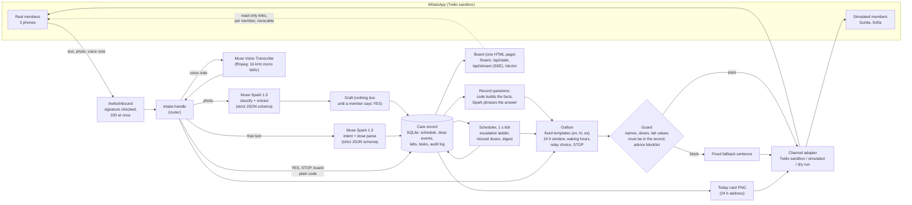

# CareCircle architecture

One rule runs through everything: **code decides, the model reads and phrases.** The Meta models turn a photo, a voice note or a sentence into structured data, or (for answers to record questions only) phrase a reply. Everything that changes the care record, decides who is messaged, or sends a message is plain code, and every outgoing message passes a guard.

## System diagram

## Message path in words

1. **Inbound.** Twilio posts to `/twilio/inbound`. The server checks the signature, answers 200 with empty TwiML at once and handles the message in the background. Media is saved with its MIME type.
2. **Router (`app/intake.py`).** A photo is classified (discharge sheet, prescription, pill organiser, lab report, other) by Muse Spark with a strict JSON schema. A voice note is converted with ffmpeg and transcribed by Muse Voice Transcribe, then treated as text. Text is first matched by fixed rules (`STOP`, `board`, `YES` and its Spanish and Hindi forms), then by Spark's intent classifier (dose update, record question, correction, volunteer, medical question, urgent symptom, relay choice, other). A message that reports a past action and asks nothing is routed as a dose report by code, because the classifier was unstable on exactly that case.
3. **Record (`app/record.py`, SQLite).** Medicines, schedule lines (draft, confirmed, stopped), dose events (due, nudged, escalated, confirmed, late, skipped, unsure, missed), documents, lab reports and values, tasks, a duty rota, relay choices, member languages and an audit log with a reason for every decision.
4. **Drafts.** An extracted discharge sheet becomes a *draft*. Nothing goes live until a member replies YES. A line the model marked unsure, or any line on a handwritten sheet, blocks YES until a member retypes the name.
5. **Scheduler (`app/escalation.py`).** Once a second: create "due" events, and for any dose past due plus 15 minutes send one private nudge to the on-duty member. If nobody answers, one step later (60 s) the next member who is awake and inside the WhatsApp window, nearby members first, then remote ones. Each skipped member is logged with the reason (asleep, chose STOP, window closed). Doses due at the same time are one question: one nudge, one relay. A dose becomes *missed* when the ladder has no one left or the next dose of the same medicine falls due.
6. **Outbox (`app/outbox.py`).** Every message goes through it: the fixed template in the member's language (`app/tmpl.py`; the model is not called), the guard, the 24 h window check, relay choice (everything, duties and alerts, a daily summary at 8 PM, or stop) and the audit line. Quiet-hours messages are queued, not dropped.
7. **Guard (`app/guard.py`).** A medicine name, dose or lab value that is not in the record (or in the sender's own message) is blocked and replaced by a fixed sentence; so is anything that matches the advice blocklist (`tests/guard_blocklist.txt`, committed before the code).
8. **Views.** `/board` is one HTML page (Server-Sent Events with a polling fallback, light by default, dark by toggle). `/doctor` is a one-page printable summary. Each member has a personal read-only link (only its hash is stored, revocable). The Today card is a 1080 x 1350 PNG at an unguessable address that expires after 24 hours.

## What the models do, and what they never do

| Job | Who | Notes |
|---|---|---|
| Read a printed sheet, prescription or lab report into fields | Muse Spark 1.3, strict JSON schema | Units kept as printed; every extraction is a draft |
| Judge which organiser compartments are full | Muse Spark 1.3 (vision) | Compared with the record by code |
| Classify intent, parse who gave which dose | Muse Spark 1.3, strict JSON schema | Constrained to the live schedule's slots |
| Hear a voice note (English, Hindi, Punjabi, mixed) | Muse Voice Transcribe | Audio converted to 16 kHz mono WAV first |
| Phrase an answer to a record question | Muse Spark 1.3 | Facts are built by code; the answer goes through the guard |
| Decide who is messaged, when, and what is stored | Code | Never the model |
| Give medical advice, interpret a value, suggest a dose | Nobody | Fixed refusal; labs are compared only with the range printed on the report |

## Files

| Area | Files |
|---|---|
| WhatsApp side | `app/server.py`, `app/channel.py`, `app/intake.py`, `app/voice.py`, `app/vision.py`, `app/prompts.py` |
| Decisions | `app/record.py`, `app/escalation.py`, `app/outbox.py`, `app/guard.py`, `app/labcore.py`, `app/labs.py` |
| Wording | `app/tmpl.py` (fixed templates en, hi, es), `app/lang.py` (free-text answers only), `app/qa.py` |
| Views | `app/board.py`, `app/board.html`, `app/labviz.py`, `app/activity.py`, `app/cards.py`, `app/links.py` |
| Demo | `app/seed.py`, `app/demo.py`, `tools/demo_reset.py`, `tools/build_replay.py`, `site/replay.html` |

## Known limits

- **Medicine-name guard.** The guard recognises a medicine name from a curated list of about 90 common drugs plus every name in the record (confirmed and draft schedule lines, the sender's own message, and a task made from a member's own message). A listed name that is not in the record is blocked; the name of a rare drug that is neither listed nor in the record is not recognised as a drug, so a bare name could pass. **The dose check and the lab-value check always apply**, whatever the name: any dose (for example "5 mg") or lab value with its unit that is not in the record or the sender's message is blocked, so a rare drug name cannot travel with a number. Units are matched as printed (including tsf and tbsp), and our own board and card links are removed before the check because their random tokens are not content.
- **Free text is the model's weakest link.** Record questions are phrased by Spark from facts that code builds; the first prompt was unstable and the final one scored 8/8, which is not proof of stability. Every answer still passes the guard.
- **The Twilio sandbox.** Three real phones, free-form messages only inside the 24-hour window, one message every 3 seconds (the app spaces its sends). There are no template sends outside the window; those messages are skipped and logged. The Meta Cloud API channel is a stub behind the same adapter.
- **One patient, one circle, one SQLite file, no login,** and the server has to be running for escalations; there is no push when it is down.
- **Extraction is as good as the photo.** Handwriting, glare and unusual layouts are handled by asking a person, not by guessing.
- **Languages.** System messages are fixed templates in English, Hindi and Spanish. Messages without a template (for example the lab-draft summary) go out in English. The Spanish templates are awaiting a fluent reader's review.
